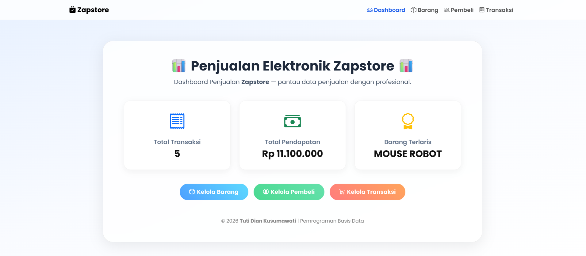

## 📌 Preview

# 🛒 Zapstore – Sistem Informasi Penjualan Elektronik

**Zapstore** merupakan aplikasi berbasis web untuk mengelola data penjualan toko elektronik. Aplikasi ini dirancang untuk membantu admin dalam mengelola data barang, pembeli, dan transaksi serta memantau ringkasan penjualan melalui dashboard.

Dashboard Zapstore menampilkan ringkasan informasi penjualan yang terdiri dari total transaksi, total pendapatan, dan barang terlaris.

## ✨ Fitur Utama

- **Dashboard** – Menampilkan ringkasan total transaksi, total pendapatan, dan barang terlaris.
- **Manajemen Barang** – Mengelola data produk elektronik.
- **Manajemen Pembeli** – Mengelola data pembeli.
- **Manajemen Transaksi** – Mengelola dan mencatat transaksi penjualan.

## 🚀 Tujuan Pengembangan

Project ini dikembangkan sebagai implementasi pembelajaran **Pemrograman Basis Data**, khususnya dalam penerapan sistem pengelolaan data penjualan menggunakan database.

## 👩‍💻 Developer

**Tuti Dian Kusumawati**

Project: Pemrograman Basis Data  
Year: 2026
